

  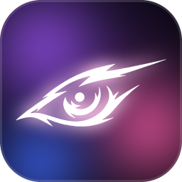

<h1 align="center">EmoStudio</h1>

  <b>Студия артов в одном окне: идея → Грок → ComfyUI → цензура → DeviantArt.</b> 
  Пишешь идею — Грок придумывает промпты, ComfyUI рисует по твоим воркфлоу, цензура аккуратно закрывает лишнее, 
  а одобренные арты превращаются в черновики на DeviantArt. Ты только выбираешь.

  

🔑 EmoStudio — программа для своих: скачать и запустить её можно только с личным ключом от автора

  
  
  
  

  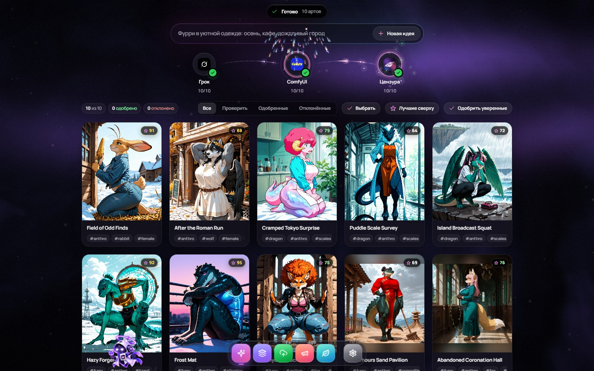 
  Готовая пачка: Грок придумал, ComfyUI нарисовал, у каждого арта оценка качества

<table>
  <tr>
    <td align="center" width="50%">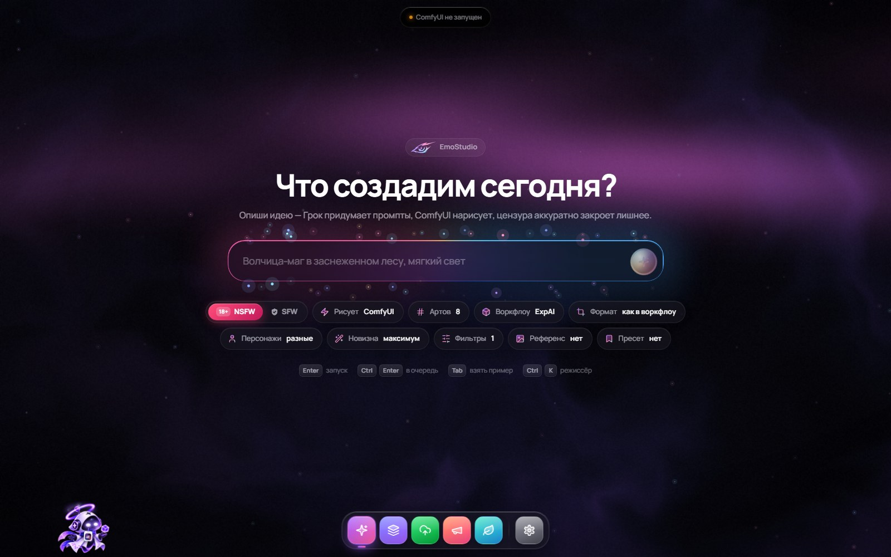 <b>Старт</b> — одно поле для идеи и пилюли настроек</td>
    <td align="center" width="50%">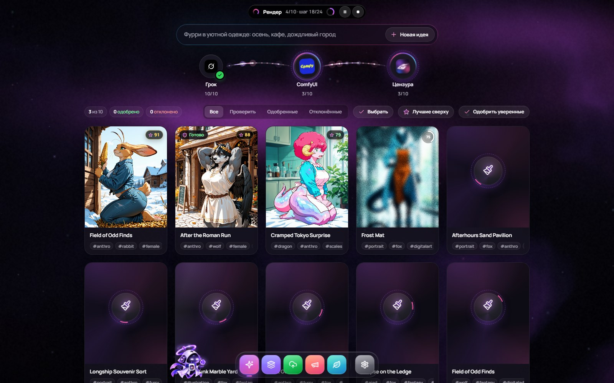 <b>Конвейер</b> — Грок → ComfyUI → цензура прямо на глазах</td>
  </tr>
  <tr>
    <td align="center">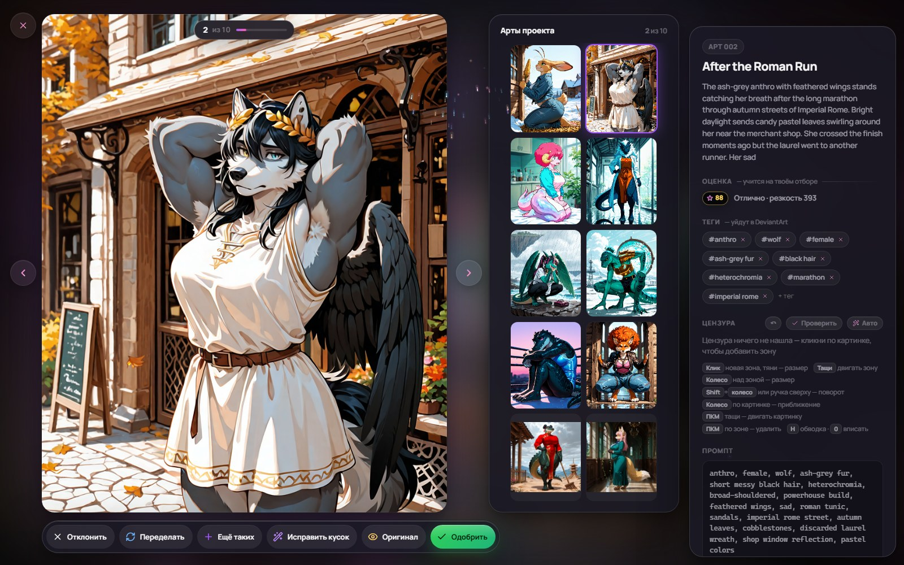 <b>Просмотр</b> — оценка, теги, промпт, правка цензуры, «Исправить кусок»</td>
    <td align="center">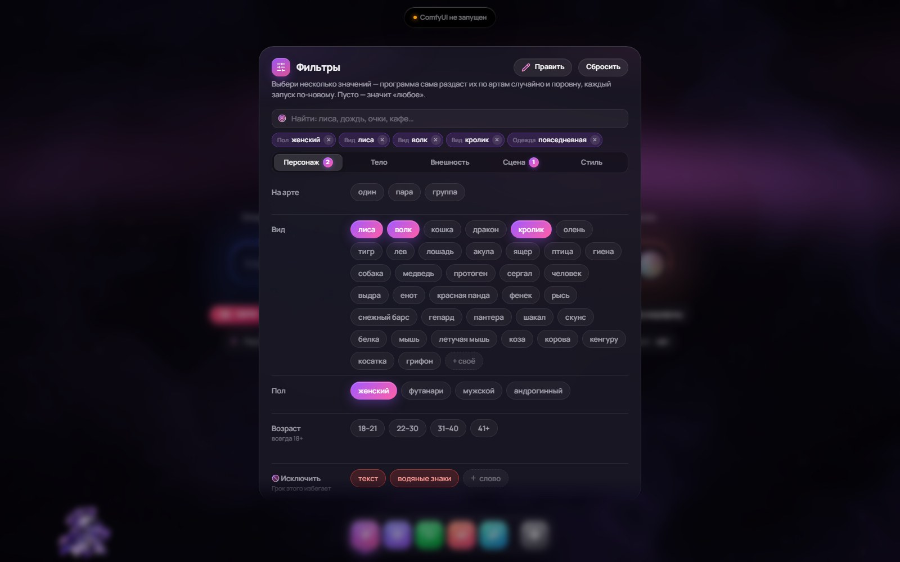 <b>Фильтры</b> — вид, пол, тело, одежда, сцена, стиль: раздаются по артам вперемешку</td>
  </tr>
  <tr>
    <td align="center">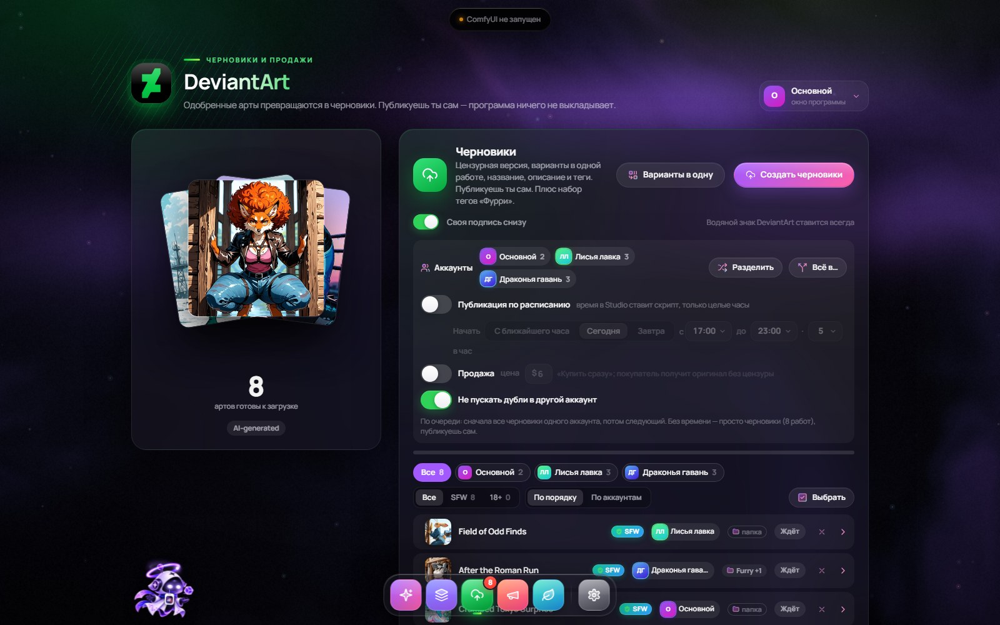 <b>DeviantArt</b> — черновики по аккаунтам, папки галереи, расписание и продажа</td>
    <td align="center">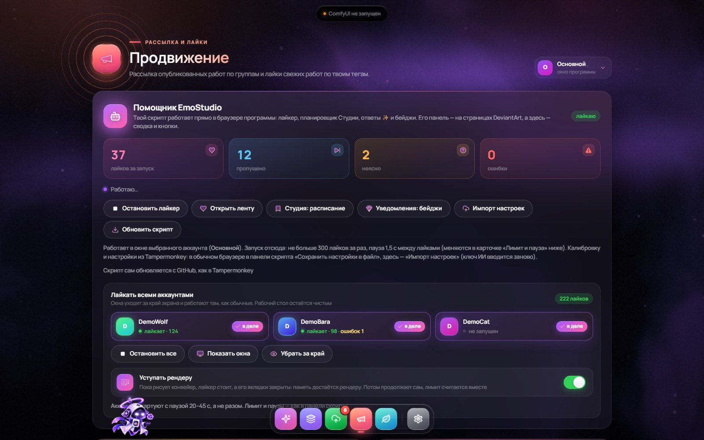 <b>Продвижение</b> — лайкер на всех аккаунтах и рассылка по группам</td>
  </tr>
  <tr>
    <td align="center">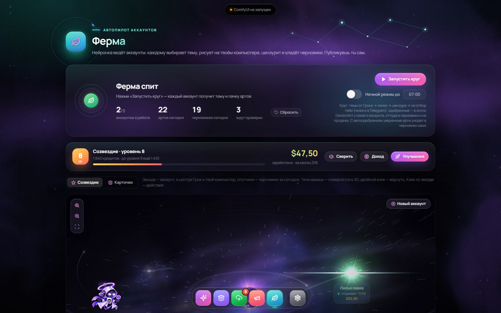 <b>Ферма</b> — нейронка сама ведёт несколько аккаунтов, «Созвездие» в 3D</td>
    <td align="center">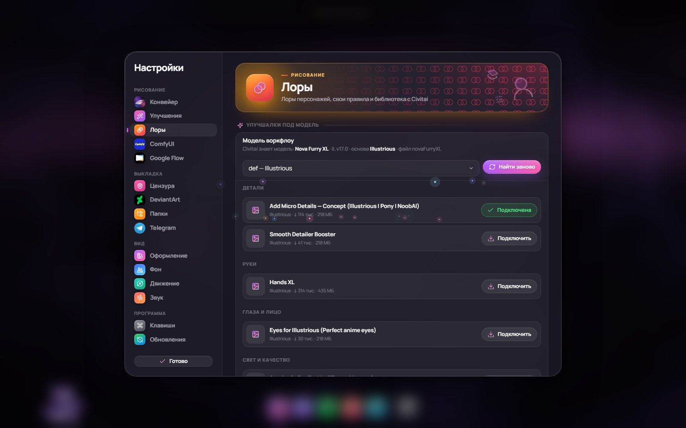 <b>Лоры</b> — программа узнаёт твою модель и подбирает лоры под неё</td>
  </tr>
  <tr>
    <td align="center">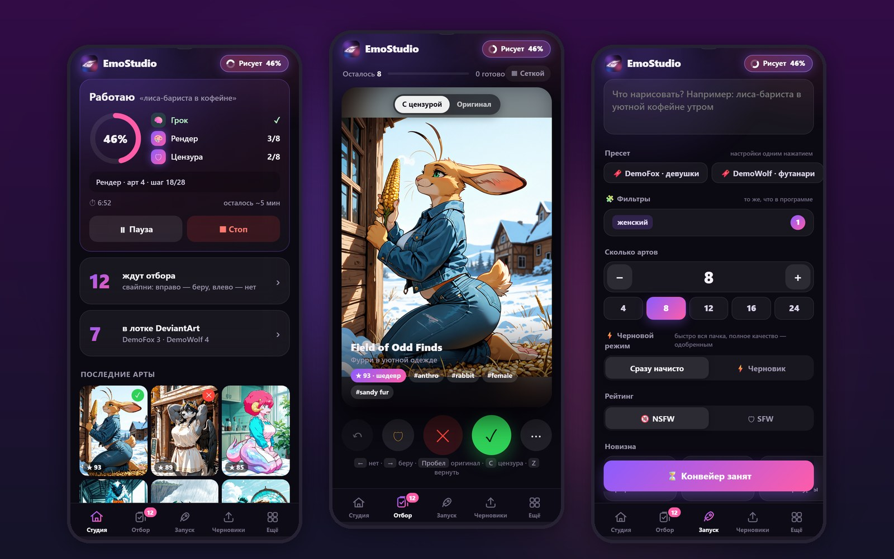 <b>Telegram</b> — бот и приложение: запуск, отбор свайпами, черновики с телефона</td>
    <td align="center">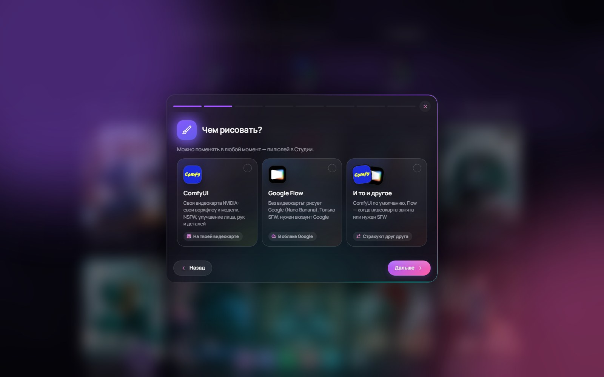 <b>Мастер первого запуска</b> — ComfyUI или Google Flow, докачка, вход, свой бот</td>
  </tr>
</table>

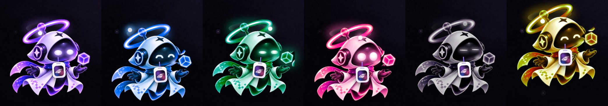 
<b>Эмо</b> — робот-помощник программы: живёт внизу окна, рисует вместе с тобой, радуется, спит ночью. 8 расцветок

Арты на скриншотах нарисованы самой программой (SFW).

---

## Содержание

- [Что умеет](#что-умеет)
- [Что нужно](#что-нужно)
- [Установка](#установка)
- [Доступ по ключу](#доступ-по-ключу)
- [Первый запуск](#первый-запуск)
- [Как пользоваться](#как-пользоваться)
- [Своя модель, свои лоры](#своя-модель-свои-лоры)
- [Референс и ControlNet](#референс-и-controlnet)
- [Google Flow вместо ComfyUI](#google-flow-вместо-comfyui)
- [DeviantArt: черновики и продажа](#deviantart-черновики-и-продажа)
- [Продвижение: лайкер и группы](#продвижение-лайкер-и-группы)
- [Ферма и созвездие](#ферма-и-созвездие)
- [Telegram: бот и приложение](#telegram-бот-и-приложение)
- [Оформление и Эмо](#оформление-и-эмо)
- [Горячие клавиши](#горячие-клавиши)
- [Как это работает](#как-это-работает)
- [Если что-то не работает](#если-что-то-не-работает)
- [Обновление](#обновление)
- [Удаление](#удаление)
- [Благодарности](#благодарности)

---

## Что умеет

**Создание**
- 💡 **Одна идея — целая пачка.** Пишешь «лисица-пиратка в шторм», выбираешь, сколько артов, — Грок придумывает каждому название, описание, теги и промпт под твою модель.
- 🎲 **Без заезженных фонов.** «Новизна» раздаёт каждому арту необычное место, палитру, позу и момент из тысяч сочетаний и помнит прошлые пачки, чтобы не повторяться. «Хаос» — полный рандом героя.
- 🧩 **Фильтры** — вид, пол, возраст, тело, мех, одежда, сцена, стиль. Несколько значений в строке раздаются по артам поровну и вперемешку. Поиск, свои значения, режим «Править», «Исключить» — чего Гроку избегать.
- 🧠 **Твои воркфлоу ComfyUI как есть.** Модель, лоры и FaceDetailer не трогаются — меняются только промпт и сид (у всех сэмплеров). Программа сама узнаёт, какая у тебя модель ([подробнее](#своя-модель-свои-лоры)).
- ☁️ **Или Google Flow** (Nano Banana) — без видеокарты, в браузере программы, с несколькими аккаунтами Google.
- 👥 **Персонажи:** разные, серия одного героя, существующий персонаж (с его лорой с Civitai — скачается сама), адопты на листе и **пак** — 30+ артов одного персонажа на продажу.
- 🦊 **Улучшение деталей** — лицо и морда, глаза, руки и лапы, ступни, интимные зоны, фон, надписи: находит и дорисовывает крупно той же моделью и лорами. Для фурри — свой детектор морд.
- 🧍 **Референс через ControlNet** — поза, контур, композиция или глубина с любой картинки, кадра из видео или 3D-манекена с пальцами.
- 🖌️ **Исправить кусок** — обведи кистью и напиши по-русски, что перерисовать. **«Ещё таких»**, **«Переделать»** с пожеланием, **рентген** проблемных мест.

**Отбор и цензура**
- 🛡️ **Автоцензура** нейросетями, обученными на рисованных артах: только головка или целиком, блюр, пиксели, полоса, плашка, сердечки или свой стикер. Зоны двигаются, вращаются, добавляются. Учится на твоих правках.
- 🔞 **NSFW / SFW** одним переключателем.
- ⭐ **Оценка качества 0–100** и проверки: лишние пальцы и части тела, повторы, надписи, пересвет. Сомнительные — во вкладку «Проверить», брак — в отклонённые.
- ⚡ **Быстрый отбор:** `A` — одобрить, `R` — отклонить, `Пробел` — оригинал, `Ctrl+Z` — отменить. Несколько артов разом — `Ctrl+клик` / `Shift+клик`.

**DeviantArt и продвижение**
- 📤 **Черновики в Studio** с названием, описанием, тегами, папками галереи и отметками AI/Mature. **Публикуешь ты сам** — программа ничего не выкладывает.
- 👥 **Несколько аккаунтов** со своими окнами браузера: вошёл один раз — переключение одной плашкой. «Разделить» раздаёт работы по аккаунтам поровну, дубли в разные аккаунты не уходят.
- 🗓️ **Время выхода** по расписанию, **продажа Exclusive** с оригиналом без цензуры покупателю, календарь выходов, «Что продаётся» и «Что заходит».
- ❤️ **Лайкер** скриптом EmoStudio на всех аккаунтах сразу, с лимитом и паузой между лайками, и рассылка работ по группам.

**Ферма и телефон**
- 🌱 **Ферма** — нейронка ведёт несколько аккаунтов: тема под нишу, пачка, цензура, отбор, черновики. Ночной режим.
- 📱 **Telegram-бот и приложение** — запуск идеи, статус с паузой и стопом, отбор свайпами, черновики, ферма и статистика с телефона. Утренний отчёт.

**Удобства**
- 🎨 **31 тема оформления**, 9 наборов значков, живые фоны, частицы и звуки, светлый и тёмный режим — всё на русском.
- 🤖 **Эмо** — робот-помощник с бейджем EmoStudio: подсказывает, рисует вместе с тобой, 8 расцветок.
- 🗂️ **Проекты** со всей историей, статистика, ачивки, ежедневные копии настроек, очистка диска в Корзину.
- 🔄 **Обновляется сама** с GitHub: настройки, входы и проекты остаются.

## Что нужно

| Что | Требование |
|---|---|
| Система | Windows 10 или 11 (64-бит) |
| Python | 3.10–3.13. Если его нет, установщик предложит поставить Python 3.12 сам |
| ComfyUI | **нет — программа поставит сама**: в мастере «Поставлю ComfyUI сам» скачает сборку под твою видеокарту (NVIDIA, AMD или Intel), модель на выбор и сделает готовый воркфлоу. Уже есть — [портативная версия](https://github.com/Comfy-Org/ComfyUI/releases) или [ComfyUI Desktop](https://www.comfy.org/download): папку, порт и запуск программа найдёт сама |
| Видеокарта | NVIDIA, 8 ГБ и больше — она нужна самому ComfyUI. Без видеокарты можно рисовать через Google Flow (только SFW) |
| Модель | любой чекпоинт SDXL: Pony, Illustrious, NoobAI или обычный SDXL — в твоём воркфлоу |
| Грок | аккаунт на [grok.com](https://grok.com) (вход один раз в окне программы) или API-ключ x.ai |
| DeviantArt | аккаунт — только если нужны черновики и продажа |
| Место на диске | около 2 ГБ без ComfyUI и его моделей |

**По желанию** (программа заметит сама и включит, мастер предложит докачать):

| Что | Зачем |
|---|---|
| [ComfyUI-Detail-Daemon](https://github.com/Jonseed/ComfyUI-Detail-Daemon) | больше мелких деталей |
| [ControlNet Union SDXL ProMax](https://huggingface.co/xinsir/controlnet-union-sdxl-1.0) (2,5 ГБ) | референс: поза, контур, композиция, глубина |
| [ComfyUI-Impact-Pack](https://github.com/ltdrdata/ComfyUI-Impact-Pack) | FaceDetailer в твоём воркфлоу (программа умеет и без него) |

## Установка

1. **Скачай программу:** открой [страницу скачивания](https://emostudio.emostudio-access-server.workers.dev), введи свой ключ `EMO-XXXX-XXXX-XXXX` и нажми «Скачать» — придёт архив `EmoStudio-…zip`. Ключа нет — попроси у автора.
2. **Распакуй туда, где программа будет жить постоянно**, например `C:\EmoStudio`. Ярлыки будут указывать на это место.
3. **Запусти `install.bat`** (двойной клик). Установщик сам:
   1. найдёт Python, а если его нет — предложит установить;
   2. создаст отдельное окружение `venv` внутри папки (в систему ничего не попадает);
   3. поставит библиотеки (самый долгий шаг, несколько минут);
   4. скачает свой браузер Chromium (около 170 МБ) — через него программа говорит с Гроком и DeviantArt, твой Chrome не трогается;
   5. соберёт `EmoStudio.exe` и создаст ярлык **EmoStudio** на рабочем столе и в «Пуске»;
   6. скачает модели цензуры (около 100 МБ — **не закрывай окно**, даже если кажется, что ничего не происходит).
4. В конце установщик спросит «Запустить сейчас?» — `Y` и `Enter`.
5. **При первом запуске программа попросит ключ** — введи тот же. Дальше откроется мастер настройки.

> 💡 Если Windows покажет «Windows защитила ваш компьютер», нажми **Подробнее → Выполнить в любом случае**. Так бывает с любыми скачанными `.bat`-файлами.

## Доступ по ключу

EmoStudio — только для своих: программа работает по личному ключу, который выдаёт автор.

- **Ключ спрашивает сама программа** перед первым использованием — без него она не откроется. Ключ проверяется на сервере доступа и привязывается к компьютеру (обычно можно на двух).
- Программа сверяет ключ при запуске и раз в несколько часов. Без интернета она работает ещё **7 дней** с последней проверки.
- Ключ отключили или он занят на других компьютерах — программа покажет это на экране ключа. «Сменить ключ» — **Настройки → Обновления → Доступ**.
- Обновления тоже приходят только по рабочему ключу.

## Первый запуск

После нажатия на ярлык сразу появляется заставка, при первом запуске — экран ключа, а за ним **мастер настройки** — по шагам, любой можно пропустить:

1. **Чем рисовать** — ComfyUI (своя видеокарта), Google Flow (без видеокарты, только SFW) или оба.
2. **ComfyUI** — находит папку сам (или «Выбрать»). Нет ComfyUI — **«Поставлю ComfyUI сам»**: сборка под видеокарту (~2 ГБ), потом выбор модели — самые скачиваемые на Civitai по стилям: аниме и фурри, фурри, Pony, реализм (~7 ГБ), и готовый воркфлоу под неё. Всё с прогрессом и докачкой после обрыва. Дальше — автозапуск и необязательные улучшалки.
3. **Google Flow** — вход в аккаунт Google в окне браузера программы.
4. **Нейросети программы** — цензура, лица, руки, оценка (около 400 МБ), чтобы первая пачка не ждала.
5. **Грок** и **DeviantArt** — войти один раз в окне браузера программы.
6. **Свой Telegram-бот** — как создать его в @BotFather и привязать (ссылку и команды можно скопировать кнопкой).

Мастер можно открыть снова: **Настройки → Обновления → «Мастер настройки»**. Всё остальное — в **Настройках** (шестерёнка в доке внизу или `Ctrl+,`).

## Как пользоваться

1. **Напиши идею** в поле посередине. `Tab` — взять пример.
2. **Настрой пилюлями под полем:**

   | Пилюля | Что задаёт |
   |---|---|
   | **NSFW / SFW** | рейтинг: в SFW Грок пишет приличные промпты, цензура сама не ставится |
   | **Рисует** | ComfyUI или Google Flow |
   | **Артов** | сколько артов и вариантов на каждый, черновой режим (быстро вся пачка, начисто — одобренные) |
   | **Воркфлоу** | каким воркфлоу ComfyUI рисовать — видно модель, её основу и лоры |
   | **Формат** | соотношение сторон, свой размер или «разные форматы» в одной пачке |
   | **Персонажи** | разные, серия, существующий, адопты или пак; одно место на всю пачку |
   | **Новизна** | от «Классики» до «Хаоса», подмешивать хаос в обычные пачки |
   | **Фильтры** | внешность, тело, одежда, сцена, стиль и что исключить |
   | **Референс** | картинка, кадр из видео или манекен для ControlNet |
   | **Пресет** | сохранённые наборы настроек — применить, обновить, переименовать |

3. **Нажми `Enter`.** Наверху загорятся станции **Грок → ComfyUI → Цензура**, карточки проявляются по мере рендера, на «острове» сверху — шаг, оставшееся время, пауза и стоп. `Ctrl+Enter` — добавить идею в очередь.
4. **Отбери арты.** Клик по карточке — крупный просмотр: `A` — одобрить (уходит в лоток DeviantArt), `R` — отклонить, держи `Пробел` — оригинал без цензуры. Там же правка зон, «Исправить кусок», «Ещё таких», «Переделать», «Улучшить детали» и «Как референс». **«Одобрить уверенные»** одобряет всё без замечаний разом.
5. **Отправь на DeviantArt** — вкладка с облаком в доке.

Файлы лежат в папке **`Projects`**: `001.png` — оригинал, `001_censored.png` — с цензурой. В **Настройках → Папки** можно задать, куда ещё складывать копии.

## Своя модель, свои лоры

EmoStudio не привязана к одной модели: у каждого свой воркфлоу, своя модель и свои лоры — программа подстраивается сама.

**Какая модель в воркфлоу.** Программа берёт из твоего воркфлоу имя модели и все лоры, а основу модели (Pony, Illustrious, NoobAI, SDXL, SD 1.5) узнаёт по отпечатку файла через Civitai — один раз на файл, до минуты в фоне. Даже если файл называется `myMix_v3`, программа поймёт, что это, и Грок будет писать промпт в нужном формате: теги e621/danbooru для аниме и фурри-моделей, описание фразами — для остальных. Модели, которой нет на Civitai, основа определяется по имени файла.

**Свои модели и лоры с компьютера.** Есть модели или лоры в «Загрузках» или в другой программе (Automatic1111, Forge, Fooocus)? **Настройки → ComfyUI → «Найти на компьютере»** (или тот же шаг в мастере): программа найдёт их, по самому файлу поймёт, где модель, а где лора и под что они (SDXL или SD 1.5), подключит к ComfyUI жёсткой ссылкой (без лишнего места), возьмёт слова-триггеры лор с Civitai и соберёт воркфлоу с цепочкой выбранных лор.

**Улучшения — твоей же моделью.** Лицо, руки, глаза, фон и «Исправить кусок» перерисовываются той же моделью и с теми же лорами, что стоят в воркфлоу. FaceDetailer из воркфлоу программа использует как есть.

**Улучшалки под модель** (**Настройки → Лоры**). Выбери воркфлоу и нажми **«Найти улучшалки»** — программа покажет самые скачиваемые на Civitai лоры деталей, рук, глаз и качества **под основу твоей модели**. «Подключить» скачивает лору в `ComfyUI\models\loras\EmoStudio-boost` и сразу добавляет правилом: она цепляется только к моделям этой основы, силу можно поменять или выключить.

**Свои лоры по правилам.** Любая лора из папки ComfyUI подключается к артам по правилу: **всегда**, **к значению фильтра** (например, «Телосложение: гипер-мышцы») или **к аккаунту**. У правила своя сила и слова-триггеры, а **«+ своя сила для…»** задаёт другую силу для части артов: девушкам и футанари, нужному виду, аккаунту или артам со словом в промпте (0 — к ним не подключать).

**Лоры персонажей.** Пишешь «loona helluva boss» или «Джуди Хопс в бикини» — Грок узнаёт персонажа, программа берёт его лору из скачанных или находит лучшую на Civitai под основу твоей модели и качает сама. Можно заранее скачать пак популярных персонажей. Детских персонажей программа не качает.

> 💡 Если модель рисует реалистичных людей, выключи **Настройки → Конвейер → «Стиль студии»**: он добавляет к промпту аниме-стиль. Детекторы рук и цензуры обучены на рисованных артах — на фотореализме проверяй цензуру глазами.

## Референс и ControlNet

Пилюля **«Референс»** → картинка или видео (из видео покажет кадры на выбор), **«Манекен»** — 3D-фигура с пальцами, которую можно поставить в любую позу. Или в просмотре арта кнопка **«Как референс»**.

| Режим | Что берёт с картинки | Когда выбирать |
|---|---|---|
| **Поза** | скелет — персонаж встанет так же, всё остальное новое | обычные позы стоя и сидя |
| **Контур** | линии рисунка — тот же силуэт и расположение | точный повтор, лёжа, вверх ногами, сложные ракурсы |
| **Композиция** | пятна цвета и расположение | перерисовать сцену в другом стиле |
| **Глубина** | объём сцены — тело и предметы не проваливаются друг в друга | кресло, диван, стол |

**«Сила»** — насколько строго держаться референса (70 % — хороший старт).

## Google Flow вместо ComfyUI

Пилюля **«Рисует»** → **Google Flow**. Картинки рисует [Google Flow](https://flow.google.com) (Nano Banana) во вкладке браузера программы — видеокарта не нужна.

- **Только SFW** — откровенное Google не пропускает.
- Пилюли **«Модель»** (лимиты примерные, на аккаунт в день) и **«Формат»**.
- **Аккаунты** — входы Google в браузере программы (**Настройки → Google Flow → «Войти в аккаунт»**). Упёрся в лимит — программа предложит продолжить на другом аккаунте.
- Нет только того, что умеет лишь ComfyUI: референса, «Исправить кусок» и «Улучшить детали».

## DeviantArt: черновики и продажа

**Черновики.** Одобренные арты копятся в лотке. **«Создать черновики»** загружает в Studio цензурные версии и заполняет название, описание, теги и отметки AI/Mature. Варианты одного арта можно собрать в одну работу. Программа нажимает только **Save to Studio** — **Submit всегда за тобой**.

**Аккаунты.** Плашка справа вверху — чей DeviantArt сейчас работает. У каждого аккаунта своё окно браузера: логин, пароль и код из аутентификатора вводишь сам один раз, дальше переключение одним нажатием.

**Раскладка.** У каждой работы в лотке — плашка аккаунта; **«Разделить»** раздаёт работы по отмеченным аккаунтам поровну. Похожие картинки остаются в одном аккаунте, а **дубли в разные аккаунты не уходят** (по одинаковым работам DeviantArt может связать аккаунты). В лотке есть фильтры, сортировка, выбор нескольких и выбор по аккаунту.

**Папки галереи.** Программа подбирает папки по теме арта (футанари — в «Futanari», персонажи из игр — в «Fan Art»), можно выбрать вручную, подгрузить папки с DeviantArt или завести недостающие.

**Время выхода.** «Публикация по расписанию» — с какого до какого часа и сколько в час: DeviantArt опубликует работы сам в выбранное время. Календарь выходов показывает неделю по аккаунтам.

**Продажа.** **«Выставить»** включает Sell as Exclusive с ценой «Купить сразу» и аукционом, а покупателю прикладывается **оригинал без цензуры**. **«Проверить»** сверяет, что приложен именно оригинал.

**Что продаётся и что заходит.** Продажи из Earnings каждого аккаунта и темы с наибольшим числом фав — это же подсказывается Гроку.

## Продвижение: лайкер и группы

- **Помощник EmoStudio** — скрипт для DeviantArt (лайкер с калибровкой, планировщик Studio, ответы ✨, бейджи) встроен в браузер программы, Tampermonkey не нужен. Сам обновляется с GitHub.
- **Лайкер.** «Лайкер» — в окне выбранного аккаунта, **«Лайкать всеми аккаунтами»** — во всех сразу (окна уходят за край экрана, рабочий стол остаётся чистым). Карточка **«Лимит и пауза»** — сколько лайков за запуск и пауза между лайками (по умолчанию 1,5 с). **«Уступать рендеру»** — пока рисует конвейер, лайкер ждёт.
- **Группы** — рассылка последних работ с профиля или из проекта по группам, отключённые пропускаются.

## Ферма и созвездие

Вкладка с листиком в доке. Ферма ведёт несколько аккаунтов DeviantArt сразу:

1. **«+ Новый аккаунт»** — название, **ниша** (о чём аккаунт), стиль, рейтинг, чем рисовать, сколько артов за круг, лимит черновиков в день, теги и цена.
2. **«Войти»** — откроется окно аккаунта, войди в DeviantArt один раз.
3. **«Запустить круг»** — Грок выбирает каждому аккаунту свежую тему под нишу, видеокарта рисует пачки по очереди, цензура, и арты приходят **на отбор** — на вкладку «Ферма» и в Telegram. Одобренные ложатся в лоток DeviantArt у своего аккаунта. **Ночной режим** повторяет круги до заданного часа.
4. **Публикуешь ты сам.**

**Созвездие** — небо в 3D: ядро в центре, звезда на аккаунт, спутники — черновики за сегодня, комета с «+$» на продажу. Заработок приносит игровые кредиты, на них открываются чудеса неба.

## Telegram: бот и приложение

1. В Telegram открой **@BotFather** → `/newbot` → придумай имя → скопируй токен.
2. **Настройки → Telegram** → вставь токен → **«Привязать»**.
3. Напиши своему боту `/start`.

**Бот:** напиши идею — предложит запуск; `/status` — что происходит, с паузой и стопом; `/review` — отбор кнопками; `/drafts` — черновики; `/farm`, `/promo`, `/stats`, `/report`. Под артом ✅/❌ и «⋯» — переделать, детали, цензура, продать. **Утренний отчёт** — заработок, что выйдет сегодня, что ждёт отбора.

**Приложение** (кнопка в боте) — программа в телефоне: студия с живым конвейером, **отбор свайпами** (вправо — беру, влево — нет), запуск с теми же фильтрами и пресетами, черновики с расписанием и продажей, статистика и настройки.

> Каждому человеку со своей EmoStudio нужен **свой бот** (минута в @BotFather): один токен в двух программах не работает.

## Оформление и Эмо

**Настройки → Оформление:** 31 тема (есть сезонные — Новый год, Хэллоуин…), свой акцентный цвет, шрифт, материал панелей (стекло, иней, неон…), 9 наборов значков, светлый и тёмный режим. **Фон** — живая сцена, частицы и декор по краю окна. **Движение** — скорость анимаций, эффекты печати и нажатий, «спокойный режим» для слабого ПК.

**Эмо** — робот-помощник программы. Живёт внизу окна, рисует вместе с тобой, радуется готовой пачке, грустит от ошибок, ночью спит. Глаза следят за курсором, двойной клик — прыжок, можно перетаскивать. 8 расцветок или «как тема» — **Настройки → Движение → «Цвет Эмо»**.

Клик по Эмо открывает его меню (закрывается крестиком, `Esc` или кликом мимо):
- **сводка** — сколько нарисовано, серия дней, что сейчас идёт;
- **«Скажи, что сделать»** — фраза уходит Режиссёру: «сделай 12 волчиц», «запусти лайкер»;
- **Дела** — пауза и стоп пачки, новая пачка, идея наугад, проверить сомнительные, одобрить уверенные, лоток, лайкер, круг фермы, статистика;
- **Разделы** — любая вкладка и любой раздел настроек в один клик;
- **Эмо** — совет, танец, перекрасить, тема наугад, поспать, порадоваться, ачивки, спрятаться.

## Горячие клавиши

| Действие | Клавиши |
|---|---|
| Запустить конвейер | `Enter` |
| Добавить идею в очередь | `Ctrl + Enter` |
| Взять пример идеи | `Tab` |
| Режиссёр: несколько задач словами | `Ctrl + K` |
| Одобрить / отклонить арт | `A` / `R` |
| Показать оригинал | `Пробел` (держать) |
| Следующий / предыдущий | `→` / `←` |
| Отменить одобрение или отклонение | `Ctrl + Z` |
| Удалить зону цензуры | `Delete` |
| Настройки | `Ctrl + ,` |
| Закрыть окно или панель | `Esc` |

## Как это работает

1. **Грок.** Программа отправляет идею и настройки в твой чат Грока через свой браузер (или через API x.ai) и получает названия, описания, теги и промпты в формате под основу твоей модели.
2. **Воркфлоу.** Твой воркфлоу переводится в API-формат самим интерфейсом ComfyUI (в невидимом браузере) — сабграфы и кастомные ноды разворачиваются правильно. Новый сид получают все сэмплеры, включая FaceDetailer. Основа модели — по отпечатку файла через Civitai.
3. **Улучшения на лету.** Лоры по правилам, Detail Daemon и ControlNet вставляются в граф прямо перед отправкой — файлы воркфлоу на диске не меняются.
4. **Рендер.** Прогресс и превью приходят из ComfyUI по websocket, ошибки переводятся на понятный язык («нет модели X — положи её в …»).
5. **Цензура.** Модели [`anime_censor_detection`](https://huggingface.co/deepghs/anime_censor_detection) находят зоны, вокруг строятся овальные зоны с мягкими краями. Ядро цензуры — из [EmoStudio Blur](https://github.com/Hesoyam-228/emostudio-blur).
6. **Оценка качества** — эстетическая модель, резкость и проверки анатомии дают балл 0–100.
7. **DeviantArt.** Черновики заполняются в Studio через тот же браузер программы, под твоим входом. Только черновики — никакой публикации.

> 🔒 Всё хранится у тебя на компьютере: настройки, токены и входы — в папке `data`, арты — в `Projects`. Программа никуда их не отправляет. Не отдавай папку `data` другим людям.

## Если что-то не работает

<b>Ключ не подходит, занят или отключён</b>

- «Такого ключа нет» — проверь, что переписал ключ без ошибок. Букв O и I и цифр 0 и 1 в ключах не бывает.
- «Ключ уже работает на других компьютерах» — у ключа есть лимит компьютеров. Попроси автора освободить место.
- «Ключ отключён» — напиши автору: если это ошибка, он включит его обратно.
- Программа давно была без интернета (больше 7 дней) — подключись к сети и нажми «Проверить снова».

<b>Установщик пишет «Подходящий Python не найден»</b>

Согласись на автоматическую установку (`Y`). Если не получилось, поставь Python 3.12 с [python.org](https://www.python.org/downloads/) и **обязательно отметь «Add python.exe to PATH»**. Потом снова запусти `install.bat`.

<b>Ошибка на шаге «Ставлю библиотеки»</b>

- Проверь интернет и запусти `install.bat` ещё раз: он продолжит с того места, где остановился.
- Если ошибка повторяется, удали папку `venv` внутри программы и запусти установку заново.
- Python 3.14 и новее пока не поддерживаются — поставь 3.12.

<b>«ComfyUI не запущен» или нет воркфлоу</b>

- Включи **Настройки → ComfyUI → «Запускать сам»** — программа сама откроет `run_nvidia_gpu.bat` (у ComfyUI Desktop — саму программу ComfyUI). Первый запуск ComfyUI занимает до двух минут.
- **ComfyUI Desktop** программа находит сама: папку с моделями и воркфлоу (обычно `Документы\ComfyUI`) и порт (8000, а не 8188). Не нашла — выбери эту папку в **Настройках → ComfyUI**. Если Desktop завис, перезапусти его из его окна.
- Воркфлоу берутся из `ComfyUI\user\default\workflows`. Сохрани воркфлоу в ComfyUI и нажми **«Обновить»** в пилюле «Воркфлоу».
- Нужен воркфлоу с обычным `KSampler` (SDXL, Pony, Illustrious, NoobAI, SD 1.5). Воркфлоу под Flux без негатива программа пометит как неподходящий.

<b>Референс: «нет модели ControlNet»</b>

Положи `diffusion_pytorch_model_promax.safetensors` из [xinsir/controlnet-union-sdxl-1.0](https://huggingface.co/xinsir/controlnet-union-sdxl-1.0) в `ComfyUI\models\controlnet` (в имени файла должны быть `union` и `sdxl`) и перезапусти ComfyUI. Или нажми «Докачать» в мастере.

<b>Грок не отвечает</b>

Открой **Настройки → Конвейер → «Открыть Грок»** и проверь, что ты вошёл в аккаунт. Если Грок недоступен в твоей стране — VPN или **«API‑ключ»**.

<b>Лоры с Civitai не качаются</b>

Часть лор (18+) Civitai отдаёт только с ключом. Он бесплатный: civitai.com → аватар → Settings → API Keys → Add API key. Вставь его в **Настройки → Лоры → «Ключ Civitai»**.

<b>Окно программы не открывается или белое</b>

Программе нужен компонент Windows **Microsoft Edge WebView2**. В Windows 11 он есть всегда, в Windows 10 — не всегда: скачай «Evergreen Bootstrapper» с [сайта Microsoft](https://developer.microsoft.com/microsoft-edge/webview2/). Если не помогло — пришли `logs\emostudio.log`.

<b>Ярлык не появился или перестал работать</b>

Запусти `EmoStudio.bat` в папке программы. Если папку перенесли или переименовали — запусти `install.bat` из нового места, он пересоздаст ярлыки.

## Обновление

Программа сама узнаёт о новой версии (раз в 6 часов): **Настройки → Обновления → «Обновиться до …»**, рядом — что нового. Программа скачает новую версию, проверит её, закроется и откроется уже новой. Меняются только файлы программы — настройки, входы, ключи, бот, проекты и окружение остаются. Если что-то пошло не так, вернётся прежняя версия (журнал — `logs\update.log`).

## Удаление

1. Удали ярлыки (из папки программы): `venv\Scripts\python src\shortcuts.py --remove`
2. Удали папку программы вместе с `data` и `Projects` (сначала сохрани нужные арты).
3. По желанию удали `%APPDATA%\EmoStudio` и модели в `%USERPROFILE%\.cache\huggingface`.

## Скрипт для DeviantArt

В этом репозитории лежит и `EmoStudio.user.js` — помощник EmoStudio для DeviantArt (лайкер, планировщик Studio, ответы, бейджи). Отдельно ставить его не нужно: программа встраивает его в свой браузер и сама берёт отсюда обновления.

## Благодарности

- [Claude](https://claude.ai) от Anthropic — помощь в разработке

---

EmoStudio · идея → арт → DeviantArt

